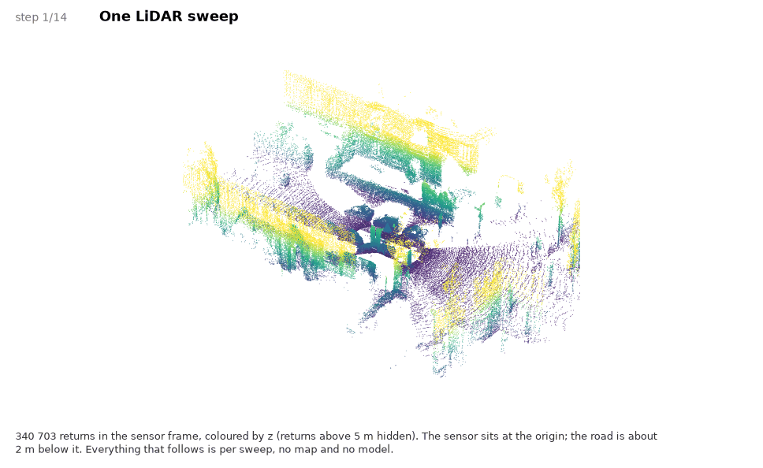

<h1 align="center">Through the Eyes of a VRU:<br>
Cooperative Perception from a Sensor-Equipped Bicycle</h1>

## Quickstart

Requires [uv](https://docs.astral.sh/uv/). Clone the repository, then run a
single command:

```bash
uv run app.py
```

The first run installs the (small) dependencies, then the viewer opens at
<http://127.0.0.1:5005> with the sample scene already loaded. Options:
`--port 8000`, `--no-browser`, `--root <folder with scenes>`.

### 1. Dataset

`samples/` holds a few frames of one recorded scene (`schwind`) in the
[nuScenes](https://www.nuscenes.org/nuscenes#data-format) format. A frame is
a fused LiDAR sweep of two cooperating agents, the **car** and the
**bicycle**, in the car's LiDAR frame.

```
samples/schwind/
├── lidar/              # frames 0, 40, 80, 120, 160, 200 (10 Hz scene, 20 s)
├── annotation/         # ground truth, nuScenes tables (3D boxes, all frames above)
├── floor.ply           # the scene's floor as a triangle mesh (global frame)
└── methods/method_a/   # detections of one method, nuScenes tables + score
```

| file | content |
|---|---|
| `lidar/<timestamp>.pcd.bin` | `float32`, 5 values per point: `x, y, z, intensity, agent` (`1` car, `2` bicycle) |
| `annotation/sample_annotation.json` | 3D boxes in the global frame (`translation`, `size` = w,l,h, `rotation` = quaternion w,x,y,z) |
| `annotation/ego_pose.json` | car pose per sample |
| `annotation/ego_pose_helper.json` | bicycle pose per sample (same schema, plus `sample_token`) |
| `floor.ply` | binary PLY triangle mesh of the ground in the global frame, a regular 0.5 m height grid (header `comment grid x0 y0 cell nx ny`, `z = NaN` where no face) |

The viewer needs the LiDAR sweeps only. If camera images are added
(`sample_data.json` rows with `fileformat` `jpg`/`png` whose files exist)
they appear in a strip below the panes; without them nothing changes.

**Viewer.** Pick the data, then the frame (or use the arrow keys), then the
agents. The top-down view is shared by all three panes (drag to pan, wheel
to zoom, double-click to reset) and oriented with the car heading up.

- **Agents** (`Car` / `Bike`, at least one stays on) restrict all three panes
  to what the selected agent(s) perceive: only their LiDAR points are drawn,
  a ground-truth box is shown if it contains at least 3 points of an active
  agent, and detections are shown if that agent produced them.
- **Floor** draws the scene's floor mesh under the points (shaded by height,
  0.2 m contour bands). Points can then be coloured by their height above the
  floor, and `Hide floor points` removes everything within 15 cm of it. Scenes
  without `floor.ply` simply hide these controls.
- Points can be coloured by height, height above floor or by agent. Boxes are coloured by class
  (`car`, `bicycle`, `pedestrian`); dashed boxes are classes outside the
  evaluation (e.g. motorcycles, bicycle racks).

### 2. Method

Each method is a folder under `samples/<scene>/methods/<id>/`: its
predictions written as a nuScenes annotation file, so a checkpoint's output
can be inspected next to the ground truth.

```
methods/<id>/
├── sample_annotation.json   # one record per detection (see below)
├── instance.json            # instance_token -> category_token
├── category.json            # names: car, bicycle, pedestrian
└── meta.json                # {"name": "<label shown in the viewer>"}
```

A detection is a regular `sample_annotation` record (`sample_token`,
`instance_token`, `translation`, `size`, `rotation`) with two extra fields:
`score` and `agent` (`car` or `bike`, the agent whose LiDAR produced it).
Drop a second folder next to `method_a` and it appears in the pane
selectors: pane 1 is the annotation, panes 2 and 3 each show one method (or
none).

**Evaluation.** The tables below the panes compare each method with the
annotation, for the current frame and over all shipped frames of the scene,
for the active agents and the current minimum score:

- Detections match ground truth of the same class by BEV centre distance
  (thresholds 0.5, 1, 2 and 4 m).
- AP is the nuScenes 101-point interpolated AP, averaged over the four
  thresholds; mAP is the mean over the classes that have ground truth.
- Only the classes the detector outputs are evaluated: `car`
  (`vehicle.car`), `bicycle` (`vehicle.bicycle`) and `pedestrian`
  (adult, child, construction worker, police officer). All other annotated
  categories are ignored.
- With both agents active, duplicate detections of the two agents are merged
  by a 1 m class-wise centre-distance NMS before evaluation.
- `TP / FP (2 m)` colours each detection by its match at 2 m.

<p align="center"></p>
